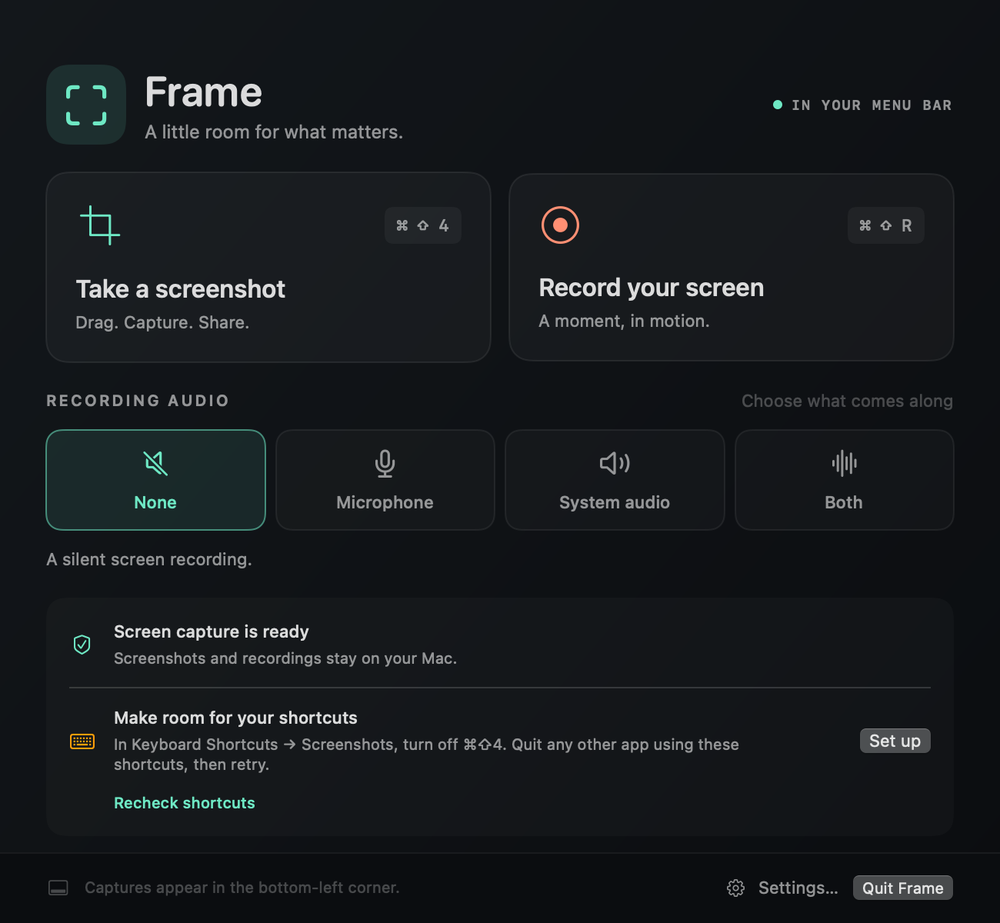
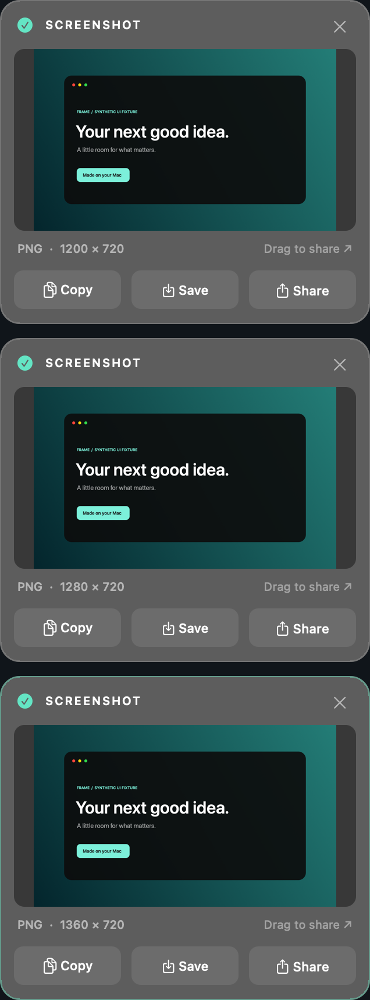

# Frame

A small native Mac app for area screenshots and screen recordings. Drag a rectangle, get a PNG or an MP4, and share it from a stack of capture cards in the corner of your screen.

<p align="center">
  <a href="https://github.com/ericrius1/frame/releases/latest/download/Frame.dmg"><b>⬇︎ Download Frame for Mac (.dmg)</b></a><br>
  <sub>macOS 15 Sequoia or later · Apple silicon and Intel · 2.4 MB</sub>
</p>

<p align="center">
  
  &nbsp;
  
</p>

## Install

1. [Download **Frame.dmg**](https://github.com/ericrius1/frame/releases/latest/download/Frame.dmg) and open it.
2. Drag **Frame** onto the **Applications** folder.
3. Open Frame from Applications.

**First launch only:** Frame is not notarized by Apple yet, so macOS says it *"cannot verify that Frame is free of malware"* and offers only **Done** or **Move to Trash**. Click **Done**, then open **System Settings → Privacy & Security**, scroll down to *"Frame was blocked…"*, click **Open Anyway**, and confirm. After that it opens normally.

<details>
<summary>Prefer the terminal?</summary>

```sh
xattr -dr com.apple.quarantine /Applications/Frame.app
open /Applications/Frame.app
```
</details>

Then grant permissions once:

- **Screen Recording:** click **Recheck** in Frame. If access is off, click **Open System Settings**, enable Frame under **Screen & System Audio Recording**, then **Quit & Reopen**.
- **Microphone:** asked the first time you record with Microphone or Both.
- **⌘⇧4 shortcut:** macOS owns ⌘⇧4 by default. If Frame shows a shortcut conflict, click **Set up**, open **Keyboard Shortcuts → Screenshots**, turn off **Save picture of selected area as a file**, then click **Recheck shortcuts**. Frame never changes your system settings itself.

## Use

| Shortcut | Does |
| --- | --- |
| **⌘⇧4** | Drag a rectangle, release to take a PNG screenshot |
| **⌘⇧R** | Drag a rectangle, pick audio, click **Record**. Press **⌘⇧R** again or click stop to finish the MP4 |
| **Space** (while dragging) | Move the whole selection without resizing it |
| **Esc** | Cancel a selection or recording setup |

Captures stack up from the bottom-left corner, newest nearest the corner, and stay until you dismiss them. Each card has **Copy**, **Save** and **Share**; drag the thumbnail into any app, or click it to open. With a card selected, **⌘C / ⌘S / ⌘W** copy, save and dismiss.

- **Save** writes straight to `~/Pictures/Frame` (no dialog). Change the folder in **Settings…** (⌘, or the gear button).
- **Recording audio:** None, Microphone, System audio, or Both. Use headphones with Both to keep speaker sound out of the mic.
- Works over full-screen apps and video. Each display has its own stack.
- Frame lives in the Dock and the menu bar; closing its window keeps the shortcuts running. Quit with ⌘Q or **Quit Frame**.

## Privacy

Everything stays on your Mac. Nothing is uploaded. Originals are kept in `~/Library/Application Support/Frame/Captures` (delete old ones whenever you like); **Save** copies them to your chosen folder.

## Details

Screenshots keep native Retina resolution. Recordings are H.264 MP4 at up to 60 fps, scaled to fit 4096 × 2304. Selections cover one display at a time. Protected/DRM content may appear blank, as with any macOS capture. Built with AppKit, SwiftUI and ScreenCaptureKit; no third-party dependencies.

## Build from source

Requires Xcode 16 or later on macOS 15+.

```sh
swift test                      # 55 unit tests
./scripts/package-dmg.sh        # universal Frame.app → dist/Frame-<version>.dmg
```

`package-dmg.sh` ad-hoc signs by default. Set `FRAME_SIGNING_IDENTITY` to a certificate's SHA-1 (`security find-identity -v -p codesigning`) to sign with it; with a Developer ID certificate, also set `FRAME_NOTARY_PROFILE` to a `notarytool store-credentials` profile to get a notarized, stapled DMG that opens with no Gatekeeper prompt.

`scripts/build.sh` is the maintainer's local install script: it builds, signs with a fixed certificate, and replaces `../Frame.app` in place. Keep one copy of Frame (bundle ID `dev.frame.capture`) on disk at a stable location so macOS keeps its Screen Recording permission across updates.

Regenerate the icon:

```sh
swift scripts/make-icon.swift .build/Frame.iconset
iconutil --convert icns --output Resources/Frame.icns .build/Frame.iconset
```
